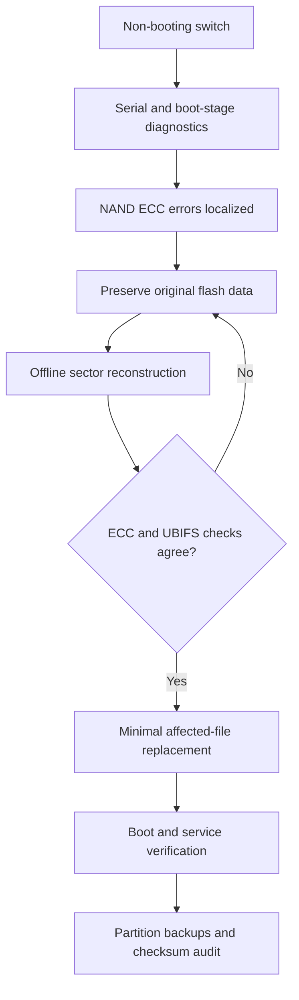

# Engineering Necromancy: Recovering an Industrial Ethernet Switch

**A four-bit NAND recovery case study — industrial systems integration, fault isolation, and offline data reconstruction**

An industrial managed Ethernet switch would no longer complete its startup sequence. Its front-panel status indicators were abnormal, application services never reached a usable state, and the system repeatedly restarted. What initially appeared to be an invalid or undecryptable firmware image turned out to be **persistent NAND read errors** affecting data required by the boot process.

The device ultimately resumed booting after an **offline reconstruction of the damaged data**, independent verification against NAND error-correction information and UBIFS node checksums, and a controlled replacement of the affected file. The investigation required a combination of electronics troubleshooting, serial-console diagnostics, Linux boot analysis, flash-memory reconstruction, and repeated validation.

> **Scope:** This is a retrospective, sanitized engineering case study of one device recovered in October 2026. It is **not** a vendor-approved service manual, turnkey reflashing procedure, vulnerability disclosure, or guarantee of permanent NAND reliability.

## At a glance

| Item | Observation / outcome |
| --- | --- |
| Equipment | RADiFlow RF-3180E family industrial Ethernet switch |
| Architecture | Freescale PowerPC P1020E, U-Boot, embedded Linux |
| Nonvolatile storage | 512 MiB NAND, UBI/UBIFS |
| Initial symptoms | Failed application startup, repeating restarts, abnormal RUN/link status |
| Primary evidence | Uncorrectable NAND ECC reports (`EBADMSG`, error `-74`); firmware verification failure |
| Data repair | Two damaged 512-byte sectors reconstructed offline; **four erroneous bits** corrected across the affected data |
| Independent checks | NAND/ECC consistency, UBIFS CRC validation, archive integrity checks |
| Recovered operation | OS/application boot resumed, RUN indicator active, management services and CLI available |
| Preservation | Four NAND partitions backed up in two representations each; **8 files checksum-verified** |
| Remaining limitations | Long-term NAND endurance and full port/network qualification were not established |

## The engineering challenge

A firmware loader may print a **verification or decryption error even when the actual fault is physical storage corruption**. Treating that message as the diagnosis, rather than as a symptom, risks replacing working boot components or wiping device-specific settings.

The investigation instead followed the evidence:

1. Verify that power, serial access, U-Boot, kernel and a maintenance environment are still reachable.
2. Identify the reproducible failure boundary and correlate it with NAND/ECC read errors.
3. Preserve the original damaged data before making changes.
4. Reconstruct the affected data **offline**, with independent structural and integrity checks.
5. Change the smallest possible on-device element and validate the resumed boot.
6. Preserve post-recovery images separately from the original failure-state material.

These are analytical phases, **not commands to run on unrelated equipment**.

## Recovery sequence



The key point was **cross-validation**: a candidate correction was not accepted merely because a particular bit flip appeared plausible. The reconstructed content had to satisfy the flash error-correction information *and* the UBIFS node integrity checks, before being considered for on-device use.

## Results, and what they do not prove

**Observed after recovery:** The system completed its normal startup sequence; relevant management/application services started; its RUN indicator became active; link negotiation and additional interface status activity were observed; the operational CLI became accessible. The device's four NAND partitions were archived in both data-area and raw/OOB representations, and all eight output files passed recorded checksum verification.

**Not established by that result:** NAND longevity, full switch-port functionality, every VLAN/SFP behavior, or the universal applicability of this approach to another hardware revision. Some physical ports were suspected to have a separate hardware fault; they should not be described as repaired by the firmware recovery.

## Repository contents

- [`docs/CASE_STUDY.md`](docs/CASE_STUDY.md) — chronological investigation with key engineering decisions.
- [`docs/TECHNICAL_FINDINGS.md`](docs/TECHNICAL_FINDINGS.md) — NAND/UBI/UBIFS and layered integrity-check observations.
- [`docs/VALIDATION.md`](docs/VALIDATION.md) — evidence, success criteria, and known open questions.
- [`docs/PUBLICATION_SAFETY.md`](docs/PUBLICATION_SAFETY.md) — items deliberately excluded from public release.
- [`tools/bitdiff.py`](tools/bitdiff.py) — read-only, generic binary comparison utility; **not** the device-specific recovery tool.
- [`tests/test_bitdiff.py`](tests/test_bitdiff.py) — tests using generated, non-proprietary synthetic bytes.

## Small, safe demonstration

The included comparison utility is deliberately generic. It can compare any two locally supplied binary files and count changed bytes and flipped bits without modifying either file:

```bash
python tools/bitdiff.py baseline.bin candidate.bin
python -m unittest discover -s tests -v
```

No manufacturer firmware, flash dumps, extracted keys, device configuration, exact repair offsets, or maintenance-access scripts are distributed in this repository. The original reconstruction scripts contained device-derived materials and have **not** been included or republished here.

## Why this project matters

The most useful lesson is not a four-bit number. It is that **root-cause isolation across disciplines**—from the physical storage medium through filesystems and cryptographic verification to runtime services—can turn an apparently dead industrial device into a recoverable system, while avoiding unnecessary destructive intervention.

## Authorship and license

Engineering case study by **Dmitry Kiseev** (2026). Documentation and the small generic comparison utility are released under the [MIT License](LICENSE); vendor software, trademarks, devices, logs, credentials and firmware remain the property of their respective owners. This repository is independent of and not endorsed by RADiFlow.